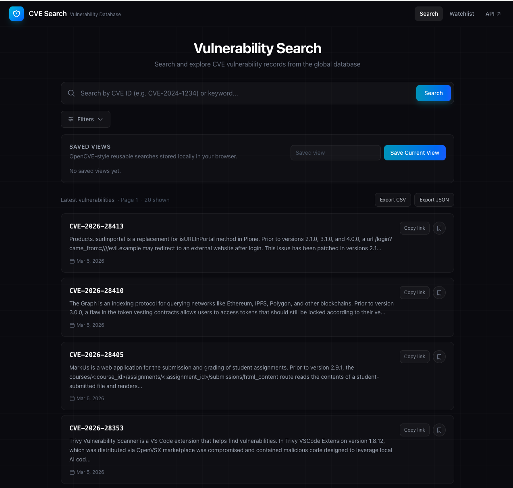
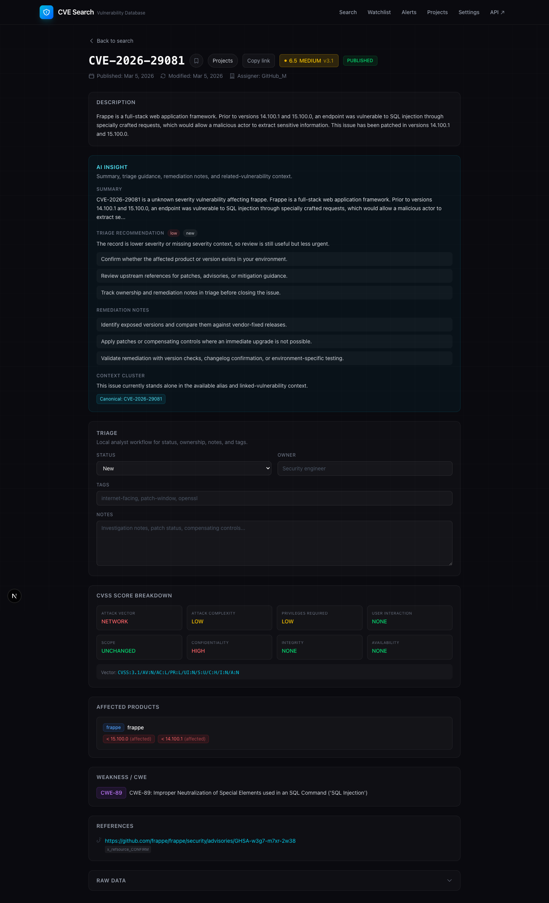
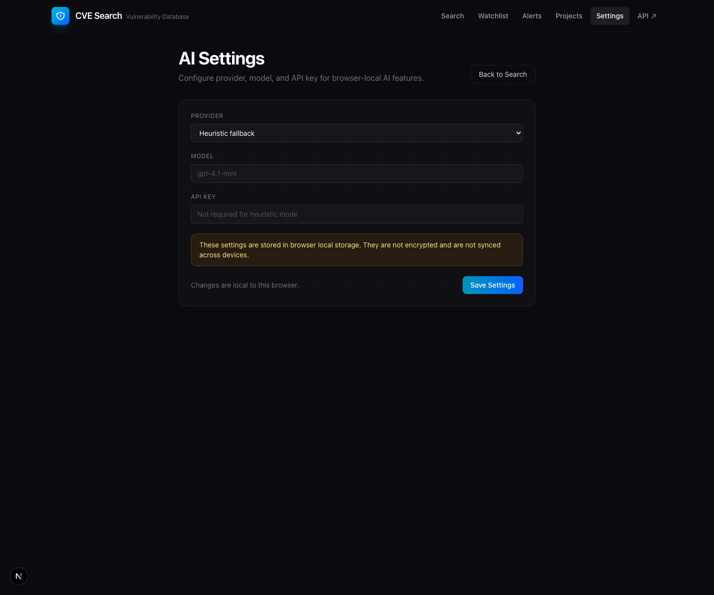

# CVE Search

Fast, analyst-friendly CVE search, GitHub repository monitoring, and automated vulnerability remediation built with Next.js.

[](https://nextjs.org/)
[](https://react.dev/)
[](https://www.typescriptlang.org/)
[](https://tailwindcss.com/)
[](./LICENSE)

## Overview

CVE Search turns raw vulnerability data into a workflow-oriented web app for research, prioritization, and operational tracking.

It combines URL-driven search, rich CVE detail pages, saved views, watchlists, alerts, triage state, and team notifications in a single interface. The app is designed to feel closer to an analyst workstation than a simple API browser.

It also includes a small, optional AI layer: natural-language search, remediation notes for findings in the exposure queue, and fix PR generation. Provider settings are managed server-side through environment variables. See `docs/adr/0001-shrink-ai-features.md` for why the AI surface is kept this small.

The GitHub Repos feature connects private and public repositories, scans their dependency trees for known vulnerabilities via the OSV.dev API, persists scan history in SQLite, and can automatically generate fix PRs using AI.

## Screenshots

### Search Workspace

URL-driven search, saved views, alert rules, analyst dashboard presets, and AI-assisted search in one screen.



### CVE Detail View

Structured vulnerability detail with triage state, CVSS context, affected products, and linked references.



### AI Settings

Server-side AI configuration dashboard showing active provider, per-feature overrides, inventory, and workspace data management.



## Highlights

- URL-driven search state for shareable result pages
- Direct CVE lookup plus keyword/product search
- Vendor and product browse assist
- Severity filters and result sorting
- Server-rendered homepage results
- Rich CVE detail pages with EPSS, CWE, CAPEC, references, comments, and linked vulnerabilities when available
- Saved views, watchlist, alerts, notifications, and triage workflow
- AI-assisted search and remediation notes
- GitHub repository monitoring with deep dependency scanning (npm, pnpm, Composer) across monorepo subdirectories
- Persisted repository scan history for monitored repos
- AI-powered vulnerability fix generation with automatic pull request creation
- Duplicate PR detection to avoid redundant fix branches
- Export to CSV and JSON
- Upstream response validation and hardened proxy behavior

## Feature Set

### Search and Prioritization

- Search by CVE ID such as `CVE-2024-1234`
- Search by keyword or product
- Filter by vendor/product pair, CWE, published-since date, and minimum severity
- Sort by newest, oldest, highest CVSS, or lowest CVSS
- Copy deep links to exact search states

### Analyst Workflow

- Save reusable searches as server-persisted saved views
- Bookmark CVEs and advisories in a server-persisted watchlist
- Create alert rules, review matches in an alerts center, and schedule digest delivery for team destinations
- Track triage status, owner, tags, and notes

### AI

- Translate natural-language prompts into structured search filters
- Draft remediation notes for a finding from the exposure queue, on demand
- Configure provider and model with server-side environment variables and per-feature overrides

### Vulnerability Detail

- CVSS score breakdown and severity badges
- EPSS lookup when a real CVE identifier is available
- Structured affected product rendering
- CWE enrichment when available
- CAPEC entries, comments, linked vulnerabilities, and references when present upstream
- Raw source payload for deeper inspection

### GitHub Repository Monitoring

- Connect private and public GitHub repositories via a personal access token
- Deep dependency scanning using the GitHub Tree API to discover dependency files across all subdirectories
- Supports npm (`package.json`, `package-lock.json`), pnpm (`pnpm-lock.yaml`), and Composer (`composer.json`, `composer.lock`)
- Batch vulnerability lookup via the OSV.dev API with CVSS v3 base score calculation
- Persisted scan snapshots per monitored repository with historical visibility in the UI
- Vulnerability detail links to internal CVE pages when a CVE alias is available
- AI-powered fix generation: analyzes the vulnerability, generates file changes, creates a branch, commits, and opens a pull request
- Heuristic fallback when no AI provider is configured (version bump to known fixed version)
- Detects existing fix PRs to prevent duplicates
- Archived and disabled repository detection with clear error messages

### Engineering Quality

- Server-rendered initial result loading
- URL-first state management
- SQLite-backed persistence for all workspace data
- Server-side API proxy with allowlisting and timeout handling
- Upstream response validation for key CIRCL payloads
- Security headers (CSP, HSTS, X-Frame-Options, X-Content-Type-Options, Referrer-Policy, Permissions-Policy)
- Rate limiting and request logging on every API route
- Parameterized SQL queries throughout
- Automated lint, test, and build checks in CI
- Heuristic AI fallback when no model provider is configured

## Security Model

> **This application is designed as a single-user local tool.** It does not include user authentication. Any visitor who can reach the server has full access to all features, including creating GitHub pull requests and triggering AI analysis.

If you expose this application on a network:

- **Place it behind a reverse proxy** with authentication (e.g., HTTP basic auth, OAuth proxy, VPN).
- **Do not expose it to the public internet** without an authentication layer in front.
- The session system assigns anonymous workspace sessions automatically — it provides data isolation between browser sessions, not access control.

The application applies rate limiting, input validation, parameterized SQL, and security headers, but none of these replace authentication for a multi-user or networked deployment.

Rate limiting uses in-memory state that resets on restart and identifies clients via request headers (`X-Forwarded-For`, `User-Agent`), which are spoofable without a trusted reverse proxy. For networked deployments, enforce client identity at the proxy layer.

The `data/` directory contains the SQLite database with all workspace state. Ensure your deployment does not serve this directory — Next.js does not expose it by default, but a misconfigured reverse proxy could make it downloadable.

## Current Boundaries

- Vendor-only filtering is intentionally blocked because the current upstream flow is only trustworthy when vendor is paired with product.
- Workspace data is scoped to the app session/user cookie rather than a shared organization identity system.
- AI providers are configured with server-side environment variables; there is no in-product credential management UI.
- Notification delivery currently persists in-app schedule and delivery records; external email/Slack/webhook delivery is modeled as destinations but not actually pushed to third-party services.
- GitHub monitoring requires a valid `GITHUB_TOKEN`; without one, the Repos workflow is limited to negative-path validation.
- Lock file regeneration (`npm install`, `composer update`) must be run locally after merging AI-generated fix PRs.

## Quick Start

```bash
git clone https://github.com/rupertgermann/cvesearch.git
cd cvesearch
npm install
```

Copy the example environment file and add your GitHub token:

```bash
cp .env.example .env.local
```

Edit `.env.local` and set `GITHUB_TOKEN` to a GitHub PAT with the required scopes (see below).

```bash
npm run dev
```

Open `http://localhost:3000`.

### Environment Variables

| Variable | Required | Description |
|---|---|---|
| `GITHUB_TOKEN` | For Repos feature | GitHub Personal Access Token. Classic PAT needs `repo` scope. Fine-grained PAT needs **Contents: Read and write** and **Pull requests: Read and write**. |
| `DATABASE_FILE` | No | Custom path for the SQLite database file. Defaults to `data/app.db`. |
| `AI_ALLOW_SENSITIVE_MODEL_DATA` | No | Set to `true` to disable redaction of sensitive triage notes and owners in prompts sent to third-party AI providers. Defaults to `false` (redaction enabled). |

### AI Configuration

To use model-backed AI features instead of the built-in heuristic fallback, configure server-side environment variables such as:

- `AI_PROVIDER` — global provider: `heuristic`, `openai`, or `anthropic`
- `OPENAI_API_KEY` / `OPENAI_MODEL`
- `ANTHROPIC_API_KEY` / `ANTHROPIC_MODEL`

OpenAI requests are sent through the Responses API. The checked-in example configuration uses `gpt-5-mini` as the default OpenAI model.
Anthropic requests are sent through the Messages API. The checked-in example configuration uses `claude-haiku-4-5-20251001` as the default Anthropic model.

You can also override individual flows with feature-specific variables `AI_SEARCH_ASSISTANT_PROVIDER`/`_MODEL` and `AI_REMEDIATION_AGENT_PROVIDER`/`_MODEL`. The `/settings` page shows the active configuration, inventory assets, and workspace import/export.

See `.env.example` for the full list of supported variables.

## Scripts

```bash
npm run dev
npm run lint
npm test
npm run build
npm start
```

## Testing

The TypeScript test suite covers:

- search-state parsing and URL generation
- prioritization and local alert matching
- triage helpers
- upstream response validation
- repository scan persistence
- notification scheduling and digest delivery
- workspace import/export
- AI platform heuristics and evaluation
- AI runs store persistence
- dependency parsing
- GitHub PR workflow and scan logic
- API route guard and rate limiting
- utility functions
- CVSS and description extraction

GitHub Actions runs `lint`, `test`, and `build` on pushes and pull requests.

## Project Structure

```text
src/
├── app/
│   ├── api/
│   │   ├── ai/              # AI search and remediation APIs
│   │   ├── alerts/          # Alert rule CRUD
│   │   ├── github/          # GitHub integration (repos, scan, fix)
│   │   ├── inventory/       # Asset inventory CRUD
│   │   ├── notifications/   # Notification schedules and delivery
│   │   ├── proxy/           # CIRCL vulnerability-lookup proxy
│   │   ├── saved-views/     # Saved view CRUD
│   │   ├── triage/          # Triage state CRUD
│   │   ├── watchlist/       # Watchlist CRUD
│   │   └── workspace/       # Export and import
│   ├── alerts/              # Alerts route
│   ├── cve/[id]/            # CVE detail route
│   ├── dashboard/           # Analyst dashboard route
│   ├── repos/               # GitHub repository monitoring route
│   ├── settings/            # Server-side AI configuration, inventory, and workspace data
│   ├── workspace/           # Notification schedules and digest history
│   ├── watchlist/           # Watchlist route
│   └── page.tsx             # Homepage
├── components/              # Search, detail, workflow, repos, and navigation UI
└── lib/                     # Search logic, AI helpers, API clients, GitHub integration,
                             # dependency parsing, SQLite-backed storage, validation, utilities

data/
└── app.db                   # Default SQLite workspace database

tests/                       # Node-based TypeScript test suite
```

## API Usage

### CIRCL vulnerability-lookup

The app talks to CIRCL through `/api/proxy`, which forwards to `https://vulnerability.circl.lu/api`.

Primary upstream endpoints:

- `GET /api/vulnerability/`
- `GET /api/vulnerability/{id}`
- `GET /api/vulnerability/search/{vendor}/{product}`
- `GET /api/vulnerability/browse/`
- `GET /api/vulnerability/browse/{vendor}`
- `GET /api/epss/{cve_id}`
- `GET /api/cwe/{cwe_id}`

### OSV.dev

Used for dependency vulnerability scanning:

- `POST /v1/querybatch` — batch lookup of dependencies by ecosystem and version
- `GET /v1/vulns/{id}` — full vulnerability details for enrichment

### GitHub API v3

Used for repository monitoring, dependency file discovery, and PR creation:

- `GET /user/repos` — list accessible repositories
- `GET /repos/{owner}/{repo}/git/trees/{sha}?recursive=1` — discover all dependency files
- `GET /repos/{owner}/{repo}/contents/{path}` — fetch file contents
- `GET /repos/{owner}/{repo}/pulls` — check for existing fix PRs
- `POST /repos/{owner}/{repo}/git/refs` — create fix branches
- `PUT /repos/{owner}/{repo}/contents/{path}` — commit file changes
- `POST /repos/{owner}/{repo}/pulls` — open pull requests

## Docs

Project documentation lives in [`docs/`](./docs):

- `docs/security-audit.md` — security audit report with findings and recommendations
- `docs/todo.md` — feature backlog and completion status
- `docs/test-user-journeys.md` — concise QA checklist
- `docs/feature-validation-playbook.md` — full feature-by-feature validation guide
- `docs/ai-platform.md` — AI platform architecture notes
- [`CHANGELOG.md`](./CHANGELOG.md)

Historical planning docs (all items completed):

- `docs/review-findings.md`
- `docs/improvement-plan.md`
- `docs/execution-backlog.md`
- `docs/opencve-benchmark.md`

## Tech Stack

- Next.js 16
- React 19
- TypeScript 5
- Tailwind CSS 4
- CIRCL vulnerability-lookup API
- OSV.dev API
- GitHub API v3
- Optional OpenAI or Anthropic provider integration

## License

[MIT](./LICENSE)
